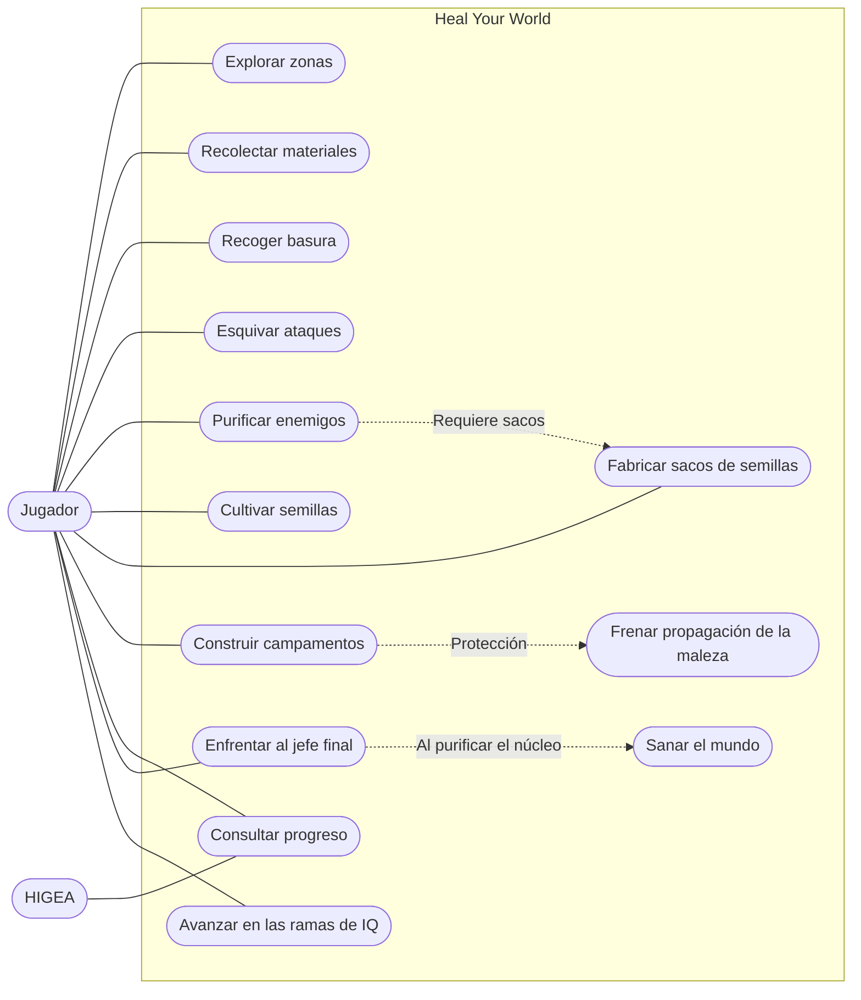

# Diagrama de casos de uso

## 1. Descripción

El siguiente diagrama representa las principales interacciones entre el jugador y el sistema del videojuego Heal Your World.

El jugador explora el mundo, recolecta recursos, cultiva semillas, construye campamentos y utiliza mecanismos de purificación para recuperar las zonas contaminadas.

## 2. Diagrama

## 3. Actores

| Actor | Descripción |
|---|---|
| Jugador | Controla al protagonista y realiza las acciones principales del videojuego. |
| HIGEA | Deidad que se comunica mediante la estatua y guía al protagonista. |

## 4. Descripción de los casos de uso

| Caso de uso | Descripción |
|---|---|
| Explorar zonas | Recorrer los diferentes biomas del mundo. |
| Recolectar materiales | Obtener recursos naturales y materiales de enemigos. |
| Recoger basura | Limpiar residuos que pueden provocar contaminación. |
| Esquivar ataques | Evitar los ataques de los enemigos corruptos. |
| Purificar enemigos | Lanzar sacos de semillas al foco de corrupción de los enemigos. |
| Cultivar semillas | Plantar semillas y recoger los brotes para obtener más recursos. |
| Fabricar sacos de semillas | Utilizar semillas y fibra para fabricar herramientas de purificación. |
| Construir campamentos | Crear estructuras que permiten establecer zonas de protección. |
| Frenar propagación de la maleza | Los campamentos protegen su radio de influencia. |
| Consultar progreso | Conocer el estado del mundo mediante la guía de HIGEA. |
| Enfrentar al jefe final | Combatir contra el brujo corrupto en la zona final. |
| Sanar el mundo | Purificar el núcleo para alcanzar el desenlace positivo. |
| Avanzar en las ramas de IQ | Mejorar las habilidades de cultivo, construcción, purificación y exploración. |

---

**Proyecto:** Heal Your World  
**Autores:** Geogan Alexander Velazquez Garcia y Alejandro Elías Moreno
