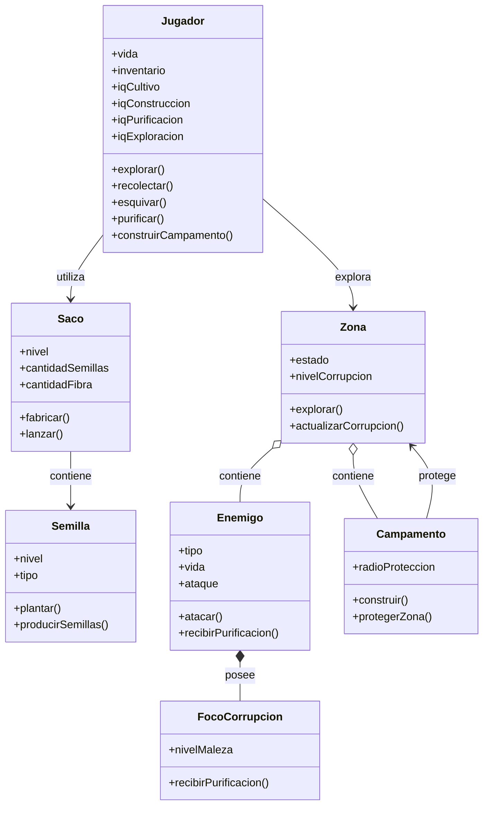

# Diagrama de clases

## 1. Descripción

El siguiente diagrama representa la estructura de clases del videojuego Heal Your World, enfocándose en las entidades principales relacionadas con el jugador, la purificación, los enemigos, las zonas y los campamentos.

Se muestran sus atributos, operaciones y relaciones para representar cómo interactúan los diferentes elementos del sistema.

## 2. Diagrama

## 3. Descripción de las clases

| Clase | Responsabilidad |
|---|---|
| Jugador | Administra las acciones del protagonista, su vida, inventario y progreso de IQ. |
| Semilla | Representa el recurso que se cultiva y se utiliza para fabricar sacos de purificación. |
| Saco | Permite almacenar semillas y fibra para realizar acciones de purificación. |
| FocoCorrupcion | Representa el punto débil de los enemigos al que deben lanzarse los sacos. |
| Enemigo | Representa las criaturas contaminadas que atacan al jugador. |
| Zona | Administra el estado de las áreas explorables y su nivel de corrupción. |
| Campamento | Establece una zona de protección que frena la propagación de la maleza. |

## 4. Relaciones entre clases

| Relación | Descripción |
|---|---|
| Jugador - Zona | El jugador puede explorar diferentes zonas. |
| Jugador - Saco | El jugador utiliza sacos para purificar enemigos. |
| Saco - Semilla | Los sacos contienen semillas utilizadas para purificar. |
| Enemigo - FocoCorrupcion | Cada enemigo posee un foco de corrupción. |
| Zona - Enemigo | Las zonas pueden contener enemigos. |
| Zona - Campamento | Las zonas pueden contener campamentos. |
| Campamento - Zona | Los campamentos protegen una parte de la zona mediante su radio de influencia. |

---

**Proyecto:** Heal Your World  
**Autores:** Geogan Alexander Velazquez Garcia y Alejandro Elías Moreno
