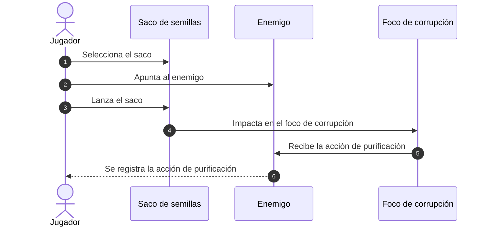

# Diagrama de secuencia

## 1. Descripción

El siguiente diagrama representa el proceso de purificación de un enemigo corrupto en Heal Your World.

El jugador utiliza un saco de semillas y lo lanza hacia el foco de corrupción del enemigo para realizar la acción de purificación.

## 2. Diagrama

## 3. Descripción de las interacciones

| Paso | Interacción | Descripción |
|---|---|---|
| 1 | Seleccionar saco | El jugador selecciona un saco de semillas de su inventario. |
| 2 | Apuntar | El jugador dirige el lanzamiento hacia el enemigo. |
| 3 | Lanzar | El jugador lanza el saco de semillas. |
| 4 | Impactar | El saco alcanza el foco de corrupción del enemigo. |
| 5 | Purificar | El foco recibe la acción de purificación. |
| 6 | Registrar acción | Se registra la acción realizada sobre el enemigo. |

## 4. Consideraciones

- Los sacos se fabrican utilizando semillas y fibra.
- Las semillas tienen diferentes niveles que se desbloquean mediante el sistema de IQ.
- El foco de corrupción representa el punto débil del enemigo.
- La purificación puede realizarse a corta o larga distancia.
- El resultado final de la purificación todavía está pendiente de definición en el documento de diseño.

---

**Proyecto:** Heal Your World  
**Autores:** Geogan Alexander Velazquez Garcia y Alejandro Elías Moreno
